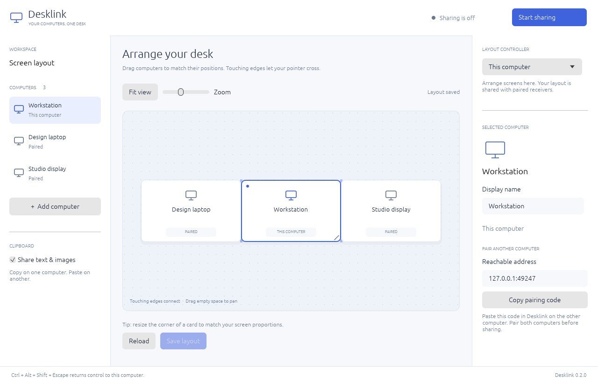
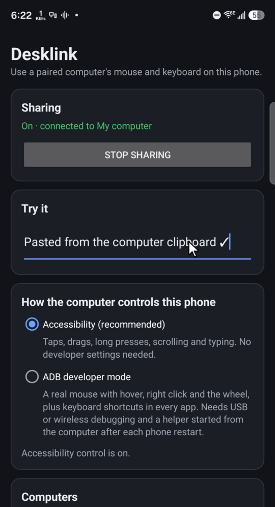

<div align="center">

# 🖱️ Desklink

### One keyboard. One mouse. Every screen on your desk, including your phone.

Move your pointer off the edge of one screen and onto the next computer, or onto your Android phone. Type there, scroll there, copy there, paste back. Nothing extra to plug in, no cloud account, and the connection is encrypted end to end.

[](https://github.com/clebermasters/desklink/actions/workflows/ci.yml)
[](LICENSE)

-555.svg)

[Quick start](#-quick-start) · [Phone setup](#-bring-your-phone) · [How it works](#-how-it-works) · [Security](#-security-you-can-reason-about) · [Docs](#-documentation)

</div>

---

## ✨ Why Desklink?

You have a laptop, a desktop and a phone, all within arm's reach. You also have three keyboards, two mice and a clipboard that never holds what you need. Desklink turns them into **one workspace**:

- **🖱️ Glide between computers.** Screens join at their touching edges like one big monitor. Push the pointer through an edge and your keyboard follows.
- **📱 Use your phone with your real mouse and keyboard.** Click to tap, type into any text field, scroll with the wheel, and paste from your computer straight into a chat on the phone.
- **📋 A clipboard that travels.** Copy text or a **PNG image with transparency** on one machine and paste it on another. It works in every direction, whichever device holds the keyboard.
- **🗺️ Arrange your desk visually.** A native layout editor lets you drag, resize and snap screen cards to match your physical setup. Left, right, top, bottom, partial overlaps, different resolutions, and rows of three or more computers are all supported.
- **🔵 Even computers without Desklink.** Your phone can stand in as a Bluetooth keyboard and mouse for a computer where you can't install anything.
- **🔐 Private by design.** Devices talk directly over your LAN with **Noise XX** encryption and **explicit pairing on both sides**. Nothing accepts a connection on first use without your approval, and nothing passes through a server.
- **🪶 Small and native.** One Rust executable per platform. No Electron, no Qt, no kernel driver and no privileged background service.
- **🛟 Always a way back.** **Ctrl+Alt+Shift+Escape** returns control to the local machine instantly, and held keys are released if a peer disappears.

> Desklink is an independent implementation. It does not use Synergy's code, account service or network protocol, and its default port (TCP 24880) avoids clashing with an existing Synergy install.

---

## 📸 See it

<table>
<tr>
<td width="62%" valign="top">

**The desk layout editor.** Drag computers into place and save. The arrangement syncs live to every paired machine.



</td>
<td width="38%" valign="top">

**The Android app on a Galaxy Z Fold7.** The text was pasted from the computer's clipboard using the computer's own keyboard.



</td>
</tr>
</table>

---

## 🚀 Quick start

You need **Rust 1.95+**.

```sh
git clone https://github.com/clebermasters/desklink.git
cd desklink
cargo build --release --locked
./target/release/desklink doctor   # checks what your desktop supports; touches nothing
./target/release/desklink          # opens the layout editor
```

Then, on every computer:

1. Open **Desklink** and copy **This computer**'s pairing code.
2. Paste it into **Add computer** on the other machine. Pair **both ways** over a channel you trust.
3. On the receiving computer, choose the **Layout controller**, the computer whose keyboard you'll use.
4. On the controller, **drag the cards** to match your desk and press **Save layout**.
5. Press **Start sharing** everywhere, then push your pointer across a shared edge. 🎉

Prefer the terminal? Each computer pairs with two commands:

```sh
desklink pairing-code                        # prints desklink://pair/...
desklink pair 'desklink://pair/...' --edge right
desklink run
```

---

## 📱 Bring your phone

Your Android phone becomes one more screen in the row. Move the pointer off the edge and it appears on the phone.

| On your computer you… | …and on the phone it… |
| --- | --- |
| click | taps; hold the button to drag or long-press |
| type | goes into the focused field (Android 13+); shortcuts like Ctrl+A/C/V work too |
| scroll the wheel | scrolls the page under the pointer |
| copy text or an image | lands on the phone's clipboard automatically |
| press Back / Escape | goes Back |

**Setup takes about two minutes:**

```sh
cd android && ./gradlew assembleDebug          # builds the Rust core through cargo-ndk
adb install -r app/build/outputs/apk/debug/app-debug.apk
scripts/android-pair.sh --edge right           # pairs phone ⇄ computer both ways over adb
```

Then on the phone, turn on **Settings → Accessibility → Desklink**, open the app and tap **Start sharing**. No adb? Exchange pairing codes by hand: open a `desklink://pair/…` link on the phone, which always asks you to confirm the computer's name and key.

Two input modes, your choice:

- **Accessibility (default).** No developer settings and no elevated access. Taps, drags, scrolling and typing.
- **ADB developer mode (opt-in).** A real mouse with hover, right-click and wheel events, plus keyboard shortcuts in every app. It uses a small helper that runs as the ordinary adb shell user, never root.

**No Desklink on that computer? 🔵 Use Bluetooth.** For a computer you can't install software on, such as a locked-down work laptop, the phone becomes a **standard Bluetooth keyboard and mouse**. Pair it in that computer's Bluetooth settings (no admin rights needed), and your Desklink computer drives it through the phone: `Linux → Wi-Fi → phone → Bluetooth → Mac`. Pick the approach per computer in the app: *It runs Desklink* or *No Desklink*. See [Bluetooth keyboard and mouse](docs/android.md#computers-without-desklink-bluetooth-keyboard-and-mouse).

✅ **Tested on real hardware:** a Samsung Galaxy Z Fold7 (Android 17) over home Wi-Fi, covering edge handoff, typing, shortcuts, scrolling and clipboard both ways. It's also covered by an 18-check emulator suite. Full guide: **[docs/android.md](docs/android.md)**.

> The phone is a receiver: your computer's mouse and keyboard control the phone, not the other way around. Android only lets apps read the clipboard while they're in front, so phone → computer copies are sent when you open Desklink or tap **Send clipboard** in its notification.

---

## 🧠 How it works

```
   ┌──────────────┐  Noise XX / TCP 24880   ┌──────────────┐         ┌──────────────┐
   │  Computer A  │ ◀─────────────────────▶ │  Computer B  │         │ Android phone│
   │ (controller) │ ◀─────────────────────────────────────────────▶ │  (receiver)  │
   └──────┬───────┘                         └──────────────┘         └──────┬───────┘
          │ captures pointer at a shared edge                               │ taps / keys / scroll
          ▼                                                                 ▼
   handoff state machine ── relative motion, keys, buttons, clipboard ──▶ same Rust engine via JNI
```

- **One engine everywhere.** The protocol, transport and handoff state machine are shared Rust crates. Desktops plug in X11, Wayland portals or Quartz. The phone plugs in an Android backend through JNI.
- **Direct connections.** The controller connects straight to each receiver, so you can cross a row of three computers in either direction without routing input through the middle one.
- **Built for the real world.** Automatic reconnection. Session IDs discard stale input. Input has priority over clipboard transfers. Simultaneous copies converge with a logical clock, and a pasted clipboard is never echoed back.

Read more in [architecture](docs/architecture.md) and the [wire protocol](docs/protocol.md).

---

## 🔐 Security you can reason about

- **No trust on first use.** Both devices must explicitly trust each other's public key before any input flows.
- **Encrypted transport:** the Noise XX handshake, then authenticated encryption for every message.
- **Your identity stays put.** Private keys are created with owner-only permissions and are never printed. On Android they live in app-private storage, excluded from backups and device transfers.
- **Least privilege.** Normal sharing runs as the signed-in user. There is no root, no driver and no system service. The Android helper is opt-in, listens only on `127.0.0.1` and requires a random 32-byte token.
- **Quiet logs.** Key codes, typed text and clipboard contents are never written to logs.

Found something? See [SECURITY.md](SECURITY.md).

---

## 🧭 Platform status

| Platform | What's there | How it's verified |
| --- | --- | --- |
| 🐧 **Linux X11** | Native UI, X11/XTEST input and clipboard | Real UI gestures, plus two- and three-desktop Xvfb suites |
| 🐧 **Linux Wayland** | Native UI, InputCapture/RemoteDesktop/Clipboard portals and EI | GNOME 48 test environment; see [status](docs/STATUS.md) |
| 📱 **Android 8+** (receiver) | Same engine via JNI; accessibility input or opt-in ADB helper; clipboard | Galaxy Z Fold7 (Android 17) over Wi-Fi; Android 15 emulator end-to-end in both input modes |
| 🍎 **macOS** | Shared UI and layout code, Quartz input, native pasteboard | Preview: earlier compile checks only, not yet tested on a Mac |

On macOS the operating system must approve input access. Wayland needs the desktop's input portals and your approval. Login screens and FileVault preboot are outside the supported scope.

---

## 📚 Documentation

| Topic | Where |
| --- | --- |
| Android setup, input modes and the security model | [docs/android.md](docs/android.md) |
| What is verified, and what isn't yet | [docs/STATUS.md](docs/STATUS.md) |
| Architecture and crates | [docs/architecture.md](docs/architecture.md) |
| Wire protocol | [docs/protocol.md](docs/protocol.md) |
| Layout editor design | [docs/layout-editor-design.md](docs/layout-editor-design.md) |
| Wayland and macOS notes | [docs/wayland.md](docs/wayland.md) · [docs/macos.md](docs/macos.md) |
| Testing | [docs/testing.md](docs/testing.md) |

<details>
<summary><b>CLI pairing with raw keys (legacy edge mode)</b></summary>

Initialize each computer:

```sh
desklink init --name "Linux desktop"
desklink identity
```

Exchange the **public** keys printed by `identity` through a channel you trust. Never copy `identity.json`, which holds the private key. With the Mac to the right of the Linux machine:

```sh
# On Linux
desklink trust MAC_PUBLIC_KEY --name Mac --address 192.168.1.20:24880 --edge right
# On the Mac
desklink trust LINUX_PUBLIC_KEY --name Linux --address 192.168.1.10:24880 --edge left
```

Run `desklink run` on both. Ctrl+C stops the program and releases input. On a Mac keyboard the escape chord is Control+Option+Shift+Escape. Both peers listen, and duplicate connections are resolved automatically. Pairing doesn't configure a firewall, so at least one peer must be reachable at its configured address.

On macOS, run `desklink permissions --request` and approve the executable in System Settings → Privacy & Security. See [macOS packaging](docs/macos.md).

</details>

<details>
<summary><b>Clipboard details</b></summary>

- Text up to 1 MiB of UTF-8. PNG up to 16 MiB and 16 million pixels.
- Clipboard sharing is on by default. Disable it with `desklink run --no-clipboard`, the editor checkbox, or `clipboard = false` in the config. When it's disabled, the clipboard is no longer read for sharing.
- File-manager copy/paste and rich text/HTML are not implemented.

</details>

<details>
<summary><b>Configuration and operations</b></summary>

`desklink config-path` prints the configuration location. `--config /path/to/config.toml` selects a separate profile with its own identity file. See [the example](examples/config.toml).

```sh
desklink doctor                    # capabilities and configuration, without capturing input
desklink status                    # the local sharing agent
desklink stop                      # release input and stop
desklink untrust PEER_PUBLIC_KEY
RUST_LOG=desklink=debug desklink run
```

Restart a CLI agent after changing configuration or trust; the GUI does this when you save. Only one process may run a given profile.

</details>

<details>
<summary><b>Builds and packaging</b></summary>

The GUI uses the system's OpenGL/EGL and the X11 or Wayland session, with no bundled toolkit. GNU/Linux GUI binaries depend on the build system's glibc. A fully static headless build avoids that:

```sh
cargo build -p desklink --release --locked --no-default-features --target x86_64-unknown-linux-musl
```

`scripts/package-linux.sh` packages the GUI. Set `DESKLINK_HEADLESS=1 DESKLINK_TARGET=x86_64-unknown-linux-musl` to package the static CLI instead. Prebuilt archives run in place (`./desklink`) and include the documentation.

</details>

---

## 🛠️ Development

```sh
cargo fmt --all -- --check
cargo clippy --workspace --all-targets -- -D warnings
cargo test --workspace --locked
python3 tests/x11_e2e.py            # two real desktops on isolated Xvfb displays
python3 tests/layout_e2e.py
python3 tests/ui_e2e.py --sharing
cargo test -p desklink-android
(cd android && ./gradlew assembleDebug) && python3 tests/android_e2e.py --serial emulator-5554
```

The integration suites need Xvfb, xdotool, xclip, xev, Python Pillow and ImageMagick. They create isolated displays and **never send test input to your real desktop**. Protocol v2 requires updating all computers from 0.1 together.

Contributions are welcome. Start with [CONTRIBUTING.md](CONTRIBUTING.md) and pick anything from the "not yet verified" list in [STATUS.md](docs/STATUS.md). Testing on new hardware helps a lot.

---

<div align="center">

**MIT licensed** for Desklink's original code. Cargo dependencies keep their own licenses.

If Desklink saves you a few context switches a day, a ⭐ helps other people find it.

</div>
